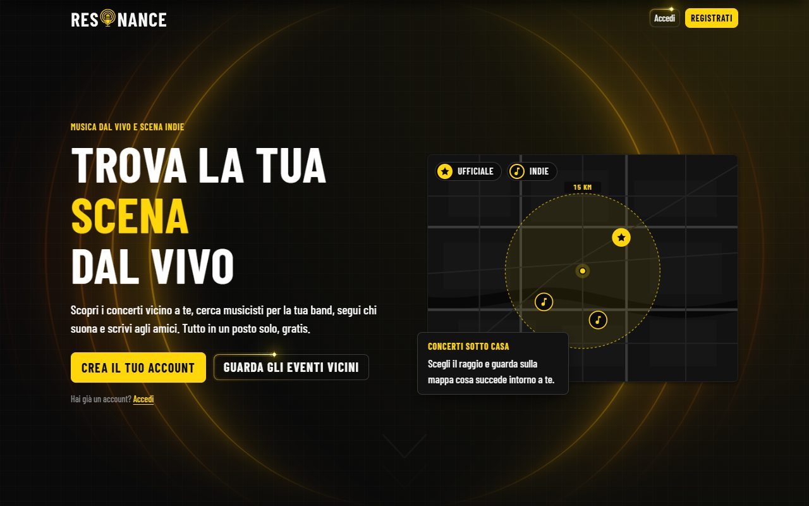
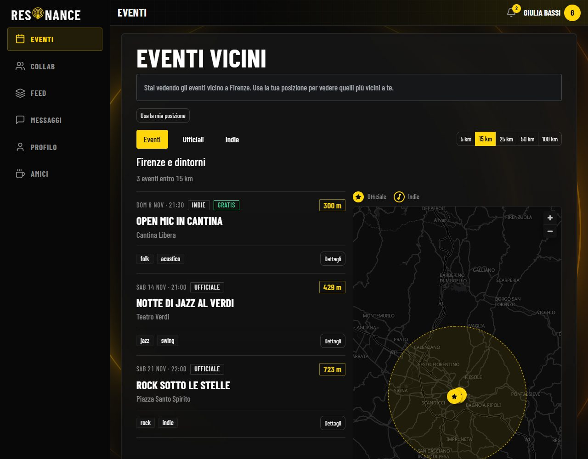
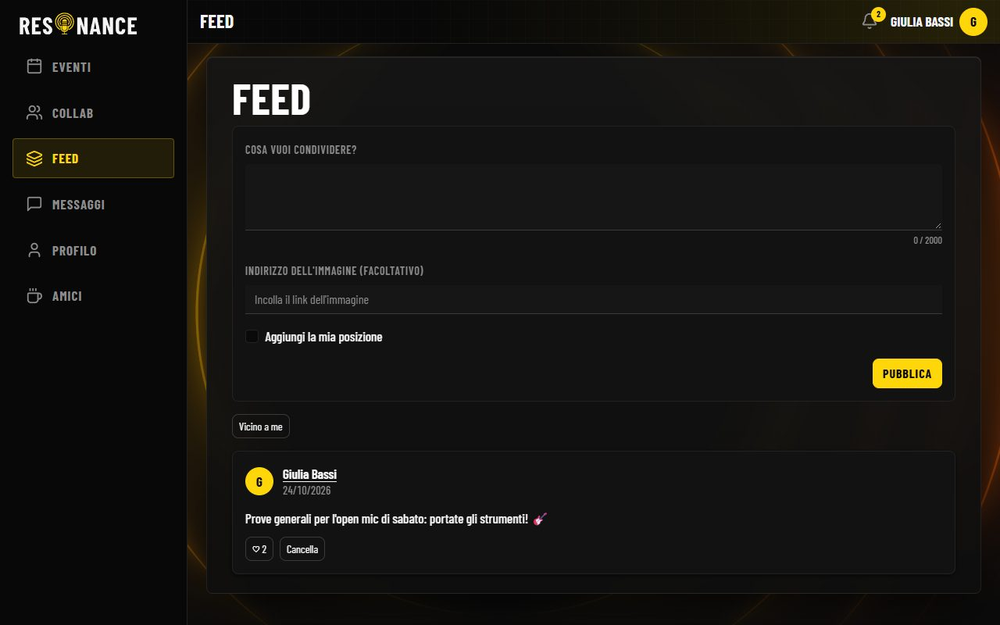
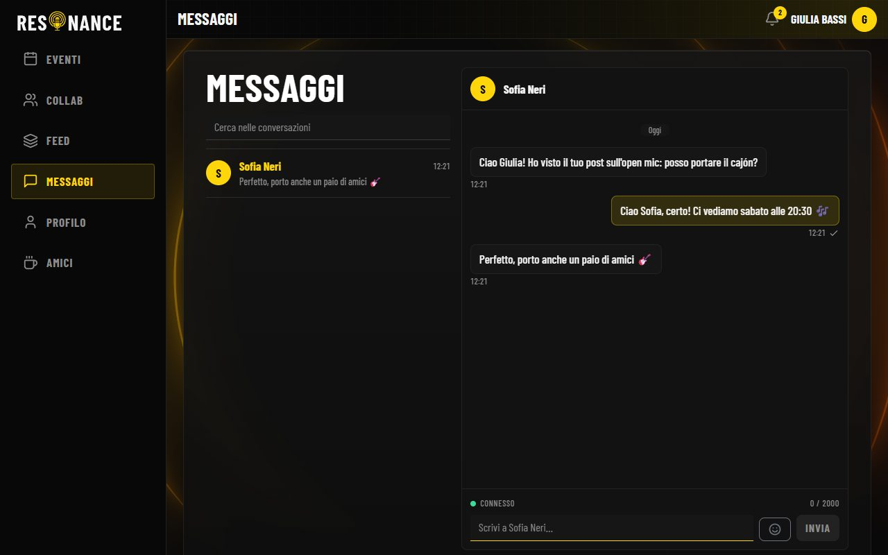

# 🎶 Resonance

Community musicale locale: **fan** 🎧, **musicisti** 🎸 e **host** 🎤 (locali e organizzatori) si trovano, scoprono i concerti vicini e si scrivono. Progetto capstone del Master Full-Stack AI Developer di Epicode (Firenze).

🌐 **Online:** https://resonance-6o89.onrender.com · 📘 **API:** `/swagger-ui.html`

| 🏠 Landing | 🗺️ Eventi vicini |
|---|---|
|  |  |
| **📰 Feed** | **💬 Chat in tempo reale** |
|  |  |

## ✨ Funzioni
- 🔐 Accesso a due token (access Bearer breve + refresh in cookie `HttpOnly`) e verifica dell'email.
- 👥 Ruoli di community (fan, musicista, host) e di piattaforma (admin, superadmin), con sospensioni e moderazione.
- 📍 Concerti ufficiali e indie event con geolocalizzazione e ricerca per raggio.
- 🤝 Annunci di collaborazione con candidature · 📰 feed con like.
- 💬 Amicizie, ricerca utenti, chat e notifiche (live e persistenti).

## 🧱 Stack
☕ Java 25, Spring Boot 4.1.1, PostgreSQL 17 + Flyway, WebSocket (STOMP) · ⚛️ React 19, TypeScript, Vite, Redux Toolkit, Bootstrap · 🐳 Docker su Render: **un solo servizio** per API e frontend, sulla stessa origine.

## 📁 Repository
`Resonance_BE/` backend · `Resonance_FE/` frontend · `docs/` brief, progettazione, decisioni, schema del database · `postman/` collection e environment.

## 🚀 Avvio in locale
Servono JDK 25, Docker e Node 24.
1. 🐘 **Database:** `docker compose up -d` dalla radice (PostgreSQL su `127.0.0.1:5433`, database `resonance` e `resonance_test`).
2. ⚙️ **Backend:** da `Resonance_BE/`, con `SPRING_PROFILES_ACTIVE=dev` e `JWT_SECRET` (almeno 32 caratteri, mai nel repository): `./mvnw spring-boot:run`. Prova: `GET http://localhost:8080/api/health`.
3. 🖥️ **Frontend:** da `Resonance_FE/`, `npm ci` e `npm run dev` su `http://localhost:5173` (proxy di `/api` e `/ws` verso la 8080).
4. 👑 **Primo SUPERADMIN:** con `SUPERADMIN_EMAIL` e `SUPERADMIN_PASSWORD` (8-72 byte) il backend lo crea all'avvio, se non esiste.
5. ✅ **Test:** `./mvnw -q verify` (database acceso) · `npm test` e `npm run lint` · `npm run preview` serve la build con la stessa CSP del backend.

🐳 Immagine di produzione, dalla **radice**: `docker build -f Resonance_BE/Dockerfile -t resonance .` (compila anche il frontend).

## 🔧 Variabili d'ambiente
Nessun segreto nel repository: in locale dalla configurazione di avvio di IntelliJ, su Render dal pannello.

| Variabile | Uso |
|---|---|
| `SPRING_PROFILES_ACTIVE` | `dev` in locale, `prod` su Render (obbligatoria). |
| `JWT_SECRET` | Firma degli access token, almeno 32 byte (obbligatoria). |
| `DATABASE_URL` · `DB_URL`, `DB_USERNAME`, `DB_PASSWORD` | Database di Render · valori diversi da quelli locali. |
| `SUPERADMIN_EMAIL`, `SUPERADMIN_PASSWORD` | Primo SUPERADMIN. |
| `BREVO_API_KEY`, `MAIL_FROM` | Invio email in produzione (in dev il codice è nel log). |
| `GEOCODING_CONTACT` | Contatto nello User-Agent verso Nominatim. |
| `PUBLIC_URL` | Indirizzo pubblico del sito, da cui le email caricano il logo (facoltativa: predefinito l'indirizzo su Render). |
| `ACCESS_TOKEN_TTL`, `REFRESH_TOKEN_TTL` · `ALLOWED_ORIGIN` · `PORT` | Durate dei token (15 min, 10 giorni) · origini CORS solo in sviluppo · porta. |

## 🛡️ Sicurezza
🔒 Password con BCrypt · 🍪 refresh con cookie `HttpOnly`, `SameSite=Lax` e header `X-Requested-With` · 🚦 limiti di frequenza su login, amicizie e creazione di eventi · 🧱 **Content-Security-Policy** sugli script (`script-src 'self'`): nel frontend niente script inline, da CDN o `eval`.

## 🚢 Deploy
Il Blueprint `render.yaml` crea database e servizio; ogni push su `main` fa il deploy, con health check su `/api/health`. 😴 Il piano gratuito si sospende dopo ~15 minuti: la prima richiesta attende il risveglio (apri `/api/health` prima di una demo). Le procedure di verifica su Render e la **checklist della demo** sono in [`docs/verifica-e-demo.md`](docs/verifica-e-demo.md).

## ⚠️ Limiti noti
- 🔗 I link scritti dagli utenti si aprono solo dopo una conferma che mostra il dominio.
- 💬 I messaggi di chat e i contatti degli eventi sono solo live (non compaiono fra le notifiche salvate).
- ✏️ I contenuti si creano e si cancellano, non si modificano · 🖼️ le immagini sono solo indirizzi (URL).
- 🎟️ Niente partecipazione agli eventi né biglietti. L'elenco completo è in `docs/progettazione.md`, sezione 15.

## 📚 Documentazione
📐 [`progettazione.md`](docs/progettazione.md) · 🧾 [`decisioni.md`](docs/decisioni.md) · 🗄️ [`schema-db.md`](docs/schema-db.md) · ♻️ [`riuso-nosey.md`](docs/riuso-nosey.md) · 📮 [`postman/`](postman/) (guida in [`verifica-e-demo.md`](docs/verifica-e-demo.md))
