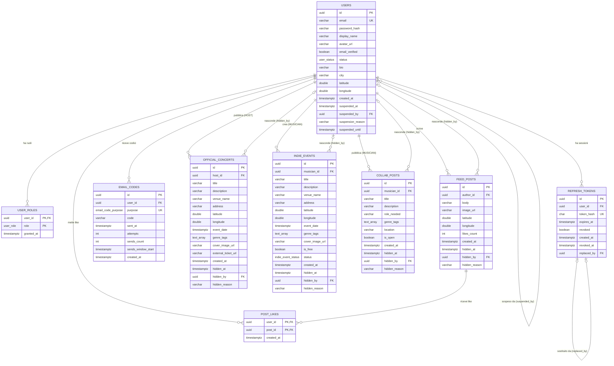

# Resonance - Schema del database

Schema PostgreSQL **effettivamente applicato** dalle migrazioni Flyway in
`Resonance_BE/src/main/resources/db/migration/`. Il modello di riferimento approvato è in
`docs/progettazione.md`, sezione 3; questo documento descrive solo ciò che le migrazioni hanno già
creato e si aggiorna a ogni migrazione che modifica lo schema, nello stesso sotto-task.

## Stato

| Migrazione | Card | Contenuto | Stato |
|---|---|---|---|
| `V1__users_and_roles` | F0-02 | enum `user_role`, `user_status`; tabelle `users`, `user_roles` | Applicata |
| `V2__refresh_tokens` | F1-02 | tabella `refresh_tokens` | Applicata |
| `V3__email_codes` | F1-03 | enum `email_code_purpose`; tabella `email_codes` | Applicata |
| `V4__official_concerts` | F3-02 | tabella `official_concerts` | Applicata |
| `V5__indie_events` | F3-03 | enum `indie_event_status`; tabella `indie_events` | Applicata |
| `V6__collab_posts` | F4-01 | tabella `collab_posts` | Applicata |
| `V7__feed_and_likes` | F4-02 | tabelle `feed_posts`, `post_likes` | Applicata |

Migrazioni ancora da fare (progettazione, sezione 3.6): `V8__friendships` (F4-04), `V9__chat` (F5-02).

## Convenzioni

- Chiavi primarie ed esterne `uuid`, `DEFAULT gen_random_uuid()`; Hibernate usa `GenerationType.UUID`.
- Timestamp `timestamptz` in UTC.
- Nomi dei vincoli espliciti: `pk_`, `uq_`, `fk_`, `ck_`, `ix_` + tabella + colonne.
- Enum PostgreSQL con valori in maiuscolo, mappati su enum Java.
- Contenuti moderabili con `hidden_at`, `hidden_by`, `hidden_reason`.
- Nessuna credenziale nelle migrazioni; nessuna modifica a migrazioni già applicate.

## Enum

| Tipo | Valori | Enum Java |
|---|---|---|
| `user_role` | `FAN`, `MUSICIAN`, `HOST`, `ADMIN`, `SUPERADMIN` | `Role` |
| `user_status` | `ACTIVE`, `SUSPENDED` | `UserStatus` |
| `email_code_purpose` | `EMAIL_VERIFICATION`, `PASSWORD_RESET` | `EmailCodePurpose` |
| `indie_event_status` | `DRAFT`, `PUBLISHED` | `IndieEventStatus` |

## Tabelle

### users

| Colonna | Tipo | Vincoli |
|---|---|---|
| `id` | uuid | PK `pk_users`, default `gen_random_uuid()` |
| `email` | varchar(255) | NOT NULL, univoca `uq_users_email`; sempre minuscola (la normalizza l'applicazione) |
| `password_hash` | varchar(100) | NOT NULL (BCrypt) |
| `display_name` | varchar(50) | NOT NULL |
| `avatar_url` | varchar(2048) | NULL; solo http/https (validato dall'applicazione) |
| `email_verified` | boolean | NOT NULL, default `false` |
| `status` | user_status | NOT NULL, default `ACTIVE` |
| `bio` | varchar(500) | NULL |
| `city` | varchar(100) | NULL, testo libero |
| `latitude` | double precision | NULL finché l'utente non condivide la posizione |
| `longitude` | double precision | NULL finché l'utente non condivide la posizione |
| `created_at` | timestamptz | NOT NULL, default `now()` |
| `suspended_at` | timestamptz | NULL |
| `suspended_by` | uuid | NULL, FK `fk_users_suspended_by` → `users(id)` |
| `suspension_reason` | varchar(500) | NULL |
| `suspended_until` | timestamptz | NULL (NULL = sospensione a tempo indeterminato) |

Vincoli di controllo:

- `ck_users_coordinates`: latitudine e longitudine sono entrambe nulle oppure entrambe presenti, con
  latitudine fra −90 e 90 e longitudine fra −180 e 180.
- `ck_users_suspension`: se `status = 'ACTIVE'` i quattro campi di sospensione sono nulli; se
  `status = 'SUSPENDED'` `suspended_at`, `suspended_by` e `suspension_reason` sono valorizzati
  (`suspended_until` resta facoltativo).

### user_roles

| Colonna | Tipo | Vincoli |
|---|---|---|
| `user_id` | uuid | FK `fk_user_roles_user` → `users(id)` ON DELETE CASCADE |
| `role` | user_role | NOT NULL |
| `granted_at` | timestamptz | NOT NULL, default `now()` |

Chiave primaria composta `pk_user_roles (user_id, role)`: una riga per ogni ruolo attivo di un
utente. Indice `ix_user_roles_role (role)` per cercare se esiste un SUPERADMIN e per gli elenchi per
ruolo.

### refresh_tokens

| Colonna | Tipo | Vincoli |
|---|---|---|
| `id` | uuid | PK `pk_refresh_tokens`, default `gen_random_uuid()` |
| `user_id` | uuid | NOT NULL, FK `fk_refresh_tokens_user` → `users(id)` ON DELETE CASCADE |
| `token_hash` | char(64) | NOT NULL, univoca `uq_refresh_tokens_hash`; SHA-256 esadecimale del valore (il valore non è salvato) |
| `expires_at` | timestamptz | NOT NULL |
| `revoked` | boolean | NOT NULL, default `false` |
| `created_at` | timestamptz | NOT NULL, default `now()` |
| `revoked_at` | timestamptz | NULL; istante della revoca, da cui parte la finestra di tolleranza di 10 secondi |
| `replaced_by` | uuid | NULL, FK `fk_refresh_tokens_replaced_by` → `refresh_tokens(id)` ON DELETE SET NULL |

Vincolo di controllo `ck_refresh_tokens_revoked`: `revoked` è vero se e solo se `revoked_at` è presente, e
`replaced_by` può essere valorizzato solo per un token revocato. Indici `ix_refresh_tokens_user (user_id)`
e `ix_refresh_tokens_expires (expires_at)` per la revoca totale e la pulizia dei token scaduti.

### email_codes

Una riga per coppia (utente, scopo): contiene il codice attivo e i contatori dei limiti di invio.

| Colonna | Tipo | Vincoli |
|---|---|---|
| `id` | uuid | PK `pk_email_codes`, default `gen_random_uuid()` |
| `user_id` | uuid | NOT NULL, FK `fk_email_codes_user` → `users(id)` ON DELETE CASCADE |
| `purpose` | email_code_purpose | NOT NULL |
| `code` | varchar(6) | NULL (NULL = nessun codice attivo, dopo l'uso); salvato in chiaro: 6 cifre hanno troppa poca entropia perché un hash protegga davvero, la protezione è data da scadenza, tentativi e limiti |
| `sent_at` | timestamptz | NULL; ultimo invio, da cui contano i 60 secondi fra due invii e i 15 minuti di validità |
| `attempts` | int | NOT NULL, default 0; tentativi di verifica consumati (massimo 5) |
| `sends_count` | int | NOT NULL, default 0; invii nella finestra corrente di 24 ore (massimo 5) |
| `sends_window_start` | timestamptz | NULL; inizio della finestra di 24 ore |
| `created_at` | timestamptz | NOT NULL, default `now()` |

Vincoli: `uq_email_codes_user_purpose (user_id, purpose)`; `ck_email_codes_code` (se `code` non è nullo,
`sent_at` non è nullo, perché la scadenza si calcola da lì). Dopo l'uso `code` torna NULL ma i contatori
restano, così l'uso di un codice non azzera i limiti di invio.

### official_concerts

Concerti pubblicati dagli utenti con ruolo HOST. Le coordinate vengono dalla geocodifica dell'indirizzo, mai dal
client.

| Colonna | Tipo | Vincoli |
|---|---|---|
| `id` | uuid | PK `pk_official_concerts`, default `gen_random_uuid()` |
| `host_id` | uuid | NOT NULL, FK `fk_official_concerts_host` → `users(id)` |
| `title` | varchar(150) | NOT NULL |
| `description` | varchar(5000) | NULL |
| `venue_name` | varchar(150) | NOT NULL |
| `address` | varchar(255) | NOT NULL; indirizzo digitato dall'host |
| `latitude` | double precision | NOT NULL; gradi, da geocodifica |
| `longitude` | double precision | NOT NULL; gradi, da geocodifica |
| `event_date` | timestamptz | NOT NULL |
| `genre_tags` | text[] | NOT NULL, default `'{}'`; minuscoli e senza duplicati (li normalizza l'applicazione) |
| `cover_image_url` | varchar(2048) | NULL; solo http/https (validato dall'applicazione) |
| `external_ticket_url` | varchar(2048) | NULL; solo http/https (validato dall'applicazione) |
| `created_at` | timestamptz | NOT NULL, default `now()` |
| `hidden_at` | timestamptz | NULL; valorizzata = contenuto nascosto (moderazione o cancellazione del proprietario) |
| `hidden_by` | uuid | NULL, FK `fk_official_concerts_hidden_by` → `users(id)` |
| `hidden_reason` | varchar(500) | NULL |

Vincoli di controllo:

- `ck_official_concerts_coordinates`: latitudine fra −90 e 90, longitudine fra −180 e 180.
- `ck_official_concerts_hidden`: `hidden_at` e `hidden_by` sono entrambi nulli o entrambi presenti, e
  `hidden_reason` può esistere solo se il contenuto è nascosto. Che il motivo sia obbligatorio per gli admin lo
  controlla il service (il database non sa chi nasconde).

Indici: `ix_official_concerts_host (host_id)`, `ix_official_concerts_coordinates (latitude, longitude)` per il
prefiltro a bounding box della ricerca nelle vicinanze e `ix_official_concerts_event_date (event_date)`.

### indie_events

Eventi creati dagli utenti con ruolo MUSICIAN, pubblicati subito o salvati come bozza. Come per i concerti, le
coordinate vengono dalla geocodifica dell'indirizzo, mai dal client. Rispetto a `official_concerts` c'è
`musician_id` al posto di `host_id`, manca `external_ticket_url` e ci sono `is_free` e `status`.

| Colonna | Tipo | Vincoli |
|---|---|---|
| `id` | uuid | PK `pk_indie_events`, default `gen_random_uuid()` |
| `musician_id` | uuid | NOT NULL, FK `fk_indie_events_musician` → `users(id)` |
| `title` | varchar(150) | NOT NULL |
| `description` | varchar(5000) | NULL |
| `venue_name` | varchar(150) | NOT NULL |
| `address` | varchar(255) | NOT NULL; indirizzo digitato dal musicista |
| `latitude` | double precision | NOT NULL; gradi, da geocodifica |
| `longitude` | double precision | NOT NULL; gradi, da geocodifica |
| `event_date` | timestamptz | NOT NULL |
| `genre_tags` | text[] | NOT NULL, default `'{}'`; minuscoli e senza duplicati (li normalizza l'applicazione) |
| `cover_image_url` | varchar(2048) | NULL; solo http/https (validato dall'applicazione) |
| `is_free` | boolean | NOT NULL, default `false` |
| `status` | indie_event_status | NOT NULL, default `'PUBLISHED'`; una bozza (`DRAFT`) la vede solo il proprietario |
| `created_at` | timestamptz | NOT NULL, default `now()` |
| `hidden_at` | timestamptz | NULL; valorizzata = evento nascosto (moderazione o cancellazione del proprietario) |
| `hidden_by` | uuid | NULL, FK `fk_indie_events_hidden_by` → `users(id)` |
| `hidden_reason` | varchar(500) | NULL |

Vincoli di controllo:

- `ck_indie_events_coordinates`: latitudine fra −90 e 90, longitudine fra −180 e 180.
- `ck_indie_events_hidden`: stessa regola di `official_concerts` (`hidden_at` e `hidden_by` insieme, motivo solo se
  nascosto).

Indici: `ix_indie_events_musician (musician_id)`, `ix_indie_events_coordinates (latitude, longitude)` per il
prefiltro a bounding box della ricerca nelle vicinanze e `ix_indie_events_event_date (event_date)`.

### collab_posts

Annunci con cui un MUSICIAN cerca un collaboratore. Un annuncio chiuso (`is_open = false`) resta consultabile ma non
compare nella lista pubblica; la cancellazione è logica.

| Colonna | Tipo | Vincoli |
|---|---|---|
| `id` | uuid | PK `pk_collab_posts`, default `gen_random_uuid()` |
| `musician_id` | uuid | NOT NULL, FK `fk_collab_posts_musician` → `users(id)` |
| `title` | varchar(150) | NOT NULL |
| `description` | varchar(5000) | NOT NULL |
| `role_needed` | varchar(100) | NOT NULL; ruolo cercato, testo libero |
| `genre_tags` | text[] | NOT NULL, default `'{}'`; minuscoli e senza duplicati (li normalizza l'applicazione) |
| `location` | varchar(150) | NULL; testo libero, non geocodificato |
| `is_open` | boolean | NOT NULL, default `true`; `false` dopo la chiusura da parte dell'autore |
| `created_at` | timestamptz | NOT NULL, default `now()` |
| `hidden_at` | timestamptz | NULL; valorizzata = annuncio nascosto (moderazione o cancellazione del proprietario) |
| `hidden_by` | uuid | NULL, FK `fk_collab_posts_hidden_by` → `users(id)` |
| `hidden_reason` | varchar(500) | NULL |

Vincoli di controllo:

- `ck_collab_posts_hidden`: stessa regola di `official_concerts` (`hidden_at` e `hidden_by` insieme, motivo solo se
  nascosto).

Indici: `ix_collab_posts_musician (musician_id)` e `ix_collab_posts_open_created (created_at DESC, id DESC)`
parziale su `is_open AND hidden_at IS NULL`, per la lista pubblica.

### feed_posts

Post del feed, scritti da qualunque utente autenticato. Le coordinate sono facoltative ma vanno insieme; la
cancellazione è logica.

| Colonna | Tipo | Vincoli |
|---|---|---|
| `id` | uuid | PK `pk_feed_posts`, default `gen_random_uuid()` |
| `author_id` | uuid | NOT NULL, FK `fk_feed_posts_author` → `users(id)` |
| `body` | varchar(2000) | NOT NULL |
| `image_url` | varchar(2048) | NULL; solo http/https, validato dall'applicazione |
| `latitude` | double precision | NULL; gradi |
| `longitude` | double precision | NULL; gradi |
| `likes_count` | integer | NOT NULL, default `0`; denormalizzato, lo aggiorna solo un UPDATE atomico del database |
| `created_at` | timestamptz | NOT NULL, default `now()` |
| `hidden_at` | timestamptz | NULL; valorizzata = post nascosto (moderazione o cancellazione del proprietario) |
| `hidden_by` | uuid | NULL, FK `fk_feed_posts_hidden_by` → `users(id)` |
| `hidden_reason` | varchar(500) | NULL |

Vincoli di controllo:

- `ck_feed_posts_coordinates`: `latitude` e `longitude` entrambe nulle o entrambe valorizzate, latitudine fra -90 e 90,
  longitudine fra -180 e 180.
- `ck_feed_posts_likes`: `likes_count >= 0` (rete di sicurezza contro i decrementi di troppo).
- `ck_feed_posts_hidden`: stessa regola di `official_concerts` (`hidden_at` e `hidden_by` insieme, motivo solo se
  nascosto).

Indici: `ix_feed_posts_author (author_id)`; `ix_feed_posts_created (created_at DESC, id DESC)` parziale su
`hidden_at IS NULL`, per la lista pubblica; `ix_feed_posts_coordinates (latitude, longitude)` parziale su
`latitude IS NOT NULL`, prefiltro a bounding box del filtro per raggio.

### post_likes

Un like per coppia utente-post: la chiave composta impedisce due like dello stesso utente. Like e unlike cambiano
`feed_posts.likes_count` nella stessa transazione, solo se hanno inserito o cancellato davvero una riga.

| Colonna | Tipo | Vincoli |
|---|---|---|
| `user_id` | uuid | NOT NULL, PK `pk_post_likes` (con `post_id`), FK `fk_post_likes_user` → `users(id)` |
| `post_id` | uuid | NOT NULL, PK `pk_post_likes` (con `user_id`), FK `fk_post_likes_post` → `feed_posts(id)` |
| `created_at` | timestamptz | NOT NULL, default `now()` |

Indice: `ix_post_likes_post (post_id)`.

## Relazioni (diagramma ER)

