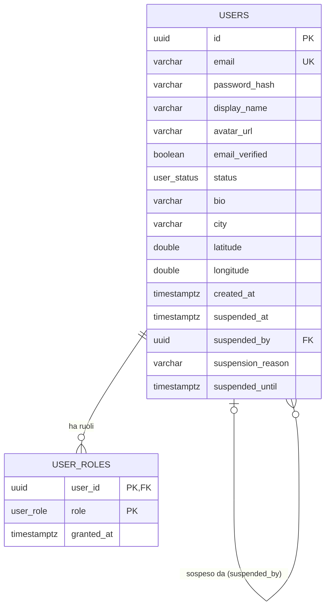

# Resonance - Schema del database

Schema PostgreSQL **effettivamente applicato** dalle migrazioni Flyway in
`Resonance_BE/src/main/resources/db/migration/`. Il modello di riferimento approvato è in
`docs/progettazione.md`, sezione 3; questo documento descrive solo ciò che le migrazioni hanno già
creato e si aggiorna a ogni migrazione che modifica lo schema, nello stesso sotto-task.

## Stato

| Migrazione | Card | Contenuto | Stato |
|---|---|---|---|
| `V1__users_and_roles` | F0-02 | enum `user_role`, `user_status`; tabelle `users`, `user_roles` | Applicata |

Migrazioni ancora da fare (progettazione, sezione 3.6): `V2__refresh_tokens` (F1-02),
`V3__email_codes` (F1-03), `V4__official_concerts` (F3-02), `V5__indie_events` (F3-03),
`V6__collab_posts` (F4-01), `V7__feed_and_likes` (F4-02), `V8__chat` (F5-02).

## Convenzioni

- Chiavi primarie ed esterne `uuid`, `DEFAULT gen_random_uuid()`; Hibernate usa `GenerationType.UUID`.
- Timestamp `timestamptz` in UTC.
- Nomi dei vincoli espliciti: `pk_`, `uq_`, `fk_`, `ck_`, `ix_` + tabella + colonne.
- Enum PostgreSQL con valori in maiuscolo, mappati su enum Java.
- Contenuti moderabili con `hidden_at`, `hidden_by`, `hidden_reason`.
- Nessuna credenziale nelle migrazioni; nessuna modifica a migrazioni già applicate.

## Enum

| Tipo | Valori | Enum Java |
|---|---|---|
| `user_role` | `FAN`, `MUSICIAN`, `HOST`, `ADMIN`, `SUPERADMIN` | `Role` |
| `user_status` | `ACTIVE`, `SUSPENDED` | `UserStatus` |

## Tabelle

### users

| Colonna | Tipo | Vincoli |
|---|---|---|
| `id` | uuid | PK `pk_users`, default `gen_random_uuid()` |
| `email` | varchar(255) | NOT NULL, univoca `uq_users_email`; sempre minuscola (la normalizza l'applicazione) |
| `password_hash` | varchar(100) | NOT NULL (BCrypt) |
| `display_name` | varchar(50) | NOT NULL |
| `avatar_url` | varchar(2048) | NULL; solo http/https (validato dall'applicazione) |
| `email_verified` | boolean | NOT NULL, default `false` |
| `status` | user_status | NOT NULL, default `ACTIVE` |
| `bio` | varchar(500) | NULL |
| `city` | varchar(100) | NULL, testo libero |
| `latitude` | double precision | NULL finché l'utente non condivide la posizione |
| `longitude` | double precision | NULL finché l'utente non condivide la posizione |
| `created_at` | timestamptz | NOT NULL, default `now()` |
| `suspended_at` | timestamptz | NULL |
| `suspended_by` | uuid | NULL, FK `fk_users_suspended_by` → `users(id)` |
| `suspension_reason` | varchar(500) | NULL |
| `suspended_until` | timestamptz | NULL (NULL = sospensione a tempo indeterminato) |

Vincoli di controllo:

- `ck_users_coordinates`: latitudine e longitudine sono entrambe nulle oppure entrambe presenti, con
  latitudine fra −90 e 90 e longitudine fra −180 e 180.
- `ck_users_suspension`: se `status = 'ACTIVE'` i quattro campi di sospensione sono nulli; se
  `status = 'SUSPENDED'` `suspended_at`, `suspended_by` e `suspension_reason` sono valorizzati
  (`suspended_until` resta facoltativo).

### user_roles

| Colonna | Tipo | Vincoli |
|---|---|---|
| `user_id` | uuid | FK `fk_user_roles_user` → `users(id)` ON DELETE CASCADE |
| `role` | user_role | NOT NULL |
| `granted_at` | timestamptz | NOT NULL, default `now()` |

Chiave primaria composta `pk_user_roles (user_id, role)`: una riga per ogni ruolo attivo di un
utente. Indice `ix_user_roles_role (role)` per cercare se esiste un SUPERADMIN e per gli elenchi per
ruolo.

## Relazioni (diagramma ER)

